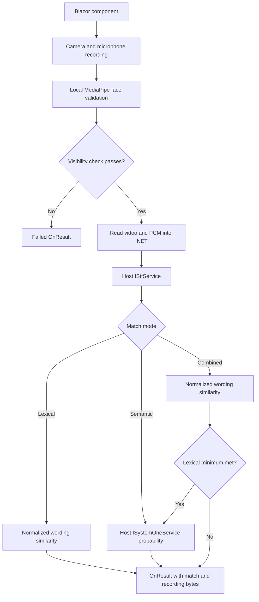

# Project index

Source analysis and implementation notes updated on 2026-10-15. This index covers maintained source, tests, and bundled assets; generated `bin/`, `obj/`, and local verification artifacts are excluded. See the [README](../README.md) for setup, usage, parameters, service contracts, and troubleshooting.

## Project structure

| Path | Role |
| --- | --- |
| [CameraSpeechMatch.slnx](../CameraSpeechMatch.slnx) | Solution containing the Razor library, local Sample host, Aspire AppHost, and .NET tests. |
| [src/CameraSpeechMatch/CameraSpeechMatch.csproj](../src/CameraSpeechMatch/CameraSpeechMatch.csproj) | `net10.0` Razor class library; Components.Web 10.0.11, MudBlazor `8.*`, and `.task` static-asset content type. |
| [src/CameraSpeechMatch.Sample/CameraSpeechMatch.Sample.csproj](../src/CameraSpeechMatch.Sample/CameraSpeechMatch.Sample.csproj) | `net10.0` ASP.NET Core host with a project reference to the library and MudBlazor `8.*`. Its root namespace is `CameraSpeechMatchSample`. |
| [.gitignore](../.gitignore) | .NET/Visual Studio build outputs and local tooling exclusions. |
| [README.md](../README.md) | User and integrator documentation. |

```text
camera-speech-match/
├── CameraSpeechMatch.slnx
├── README.md
├── docs/AGENT.md
├── tests/                       .NET service/component tests
└── src/
    ├── CameraSpeechMatch/
    │   ├── CameraSpeechMatch.razor / .razor.cs / .razor.css
    │   ├── service interfaces, request types, result, mode, comparer
    │   └── wwwroot/
    │       ├── js/                   browser recording, face checks, PCM capture
    │       ├── vendor/mediapipe/1.0.1/
    │       └── background.png
    └── CameraSpeechMatch.Sample/
        ├── Program.cs
        ├── Configuration/          local Ollama settings
        ├── Services/Ollama/         local model adapters and readiness
        ├── Components/             app shell, routing, layout, pages
        ├── Properties/launchSettings.json
        ├── appsettings*.json
        └── wwwroot/app.css
```

## Local Ollama and Aspire execution

The Sample runs entirely through the host's existing Ollama. See [Sample setup](../src/CameraSpeechMatch.Sample/README.md) for commands and configuration. The Sample contains only Ollama adapters and settings. The reusable library uses `TranscribeRequest` and `MatchProbabilityRequest` for its service contracts; browser recording contracts are unchanged.

| Source | Responsibility |
| --- | --- |
| `src/CameraSpeechMatch.Sample/Configuration/OllamaSettings.cs` | Validated centralized model names, endpoint, deadlines, size bounds, and decision certainty. |
| `src/CameraSpeechMatch.Sample/Services/Ollama/OllamaClient.cs` | Typed HTTP client, bounded strict JSON, HTTP errors, cancellation, and body-inclusive deadlines. |
| `src/CameraSpeechMatch.Sample/Services/Ollama/OllamaSttService.cs` | Existing ISttService; raw PCM to in-memory WAV, 30-second windows, actual audio in chat images, ASR marker parsing. |
| `src/CameraSpeechMatch.Sample/Services/Ollama/OllamaSystemOneService.cs` | Existing ISystemOneService; structured Jev noul question and strict/uncertainty validation. |
| `src/CameraSpeechMatch.Sample/Services/Ollama/OllamaReadiness.cs` | Bounded background startup checks for version, exact installed names, audio/decision capabilities; shared UI/health status. |
| `src/CameraSpeechMatch.Sample/Services/Ollama/OllamaServiceCollectionExtensions.cs` | Local DI, configuration validation, and Aspire external-service endpoint resolution. |
| `src/CameraSpeechMatch.AppHost/` | Aspire 13.6.1 AppHost: external host Ollama and Sample project, with service reference and health checks. No containers or model downloads. |
| `tests/CameraSpeechMatch.Tests/OllamaServiceTests.cs` | Offline protocol, audio, limits, errors, cancellation/deadlines, readiness, DI, and configuration tests. |
| `tests/CameraSpeechMatch.Tests/OllamaIntegrationTests.cs` | Opt-in exact-model readiness, typed semantic checks, and real audio-to-text-to-decision test. |
| `tests/CameraSpeechMatch.AppHost.Tests/` | Opt-in real AppHost/Sample startup and service discovery against an ephemeral local Ollama protocol double. |

Default data flow: browser face validation and PCM capture -> existing component -> OllamaSttService -> Ollama `/api/chat` with WAV audio -> lexical comparison and/or OllamaSystemOneService -> `/v1/systemone` -> existing result contract. The AppHost manages only the Sample and references host Ollama. Startup readiness does not imply a model has successfully completed inference; run the opt-in integration tests to verify actual model execution.

## Library source map

| File | Responsibility and useful entry points |
| --- | --- |
| [CameraSpeechMatch.razor](../src/CameraSpeechMatch/CameraSpeechMatch.razor) | MudBlazor UI: recording controls, prompt, camera preview, face guidance, timer, transcript, and results. |
| [CameraSpeechMatch.razor.cs](../src/CameraSpeechMatch/CameraSpeechMatch.razor.cs) | Component parameters and state, JS import, auto-start, video/PCM reading, transcription, matching, retry, cancellation, and disposal. Both completion callbacks share `CompleteTranscriptionAsync`; `OnTranscriptionCompletedWithPcm` accepts the separate PCM stream. |
| [CameraSpeechMatch.razor.css](../src/CameraSpeechMatch/CameraSpeechMatch.razor.css) | Isolated responsive styling. The live preview uses centered `object-fit: cover` with horizontal mirroring; recorded playback removes mirroring. |
| [_Imports.razor](../src/CameraSpeechMatch/_Imports.razor) | Component Web and MudBlazor imports. |
| [CameraSpeechMatchMode.cs](../src/CameraSpeechMatch/CameraSpeechMatchMode.cs) | Public `Lexical`, `Semantic`, and `Combined` match modes, preserving enum values 0 and 1 for existing modes. |
| [CameraSpeechMatchResult.cs](../src/CameraSpeechMatch/CameraSpeechMatchResult.cs) | Processing status (`Succeeded`), acceptance (`IsAccepted`), lexical/semantic scores and active minimums, text, media bytes/metadata, and errors. Combined captures both minimums; its semantic score is null when the lexical minimum fails. Completed mismatches retain media. Audio uses the video's base file name with `.pcm` and media type `application/octet-stream`. Successful results reuse the PCM bytes passed to STT. |
| [ISttService.cs](../src/CameraSpeechMatch/ISttService.cs) | Host transcription boundary: `IsAvailable` and `TranscribeAsync`. The implementation owns language selection. |
| [TranscribeRequest.cs](../src/CameraSpeechMatch/TranscribeRequest.cs) | Automatically captured `PcmAudioContent`. PCM is fixed at mono 16 kHz signed 16-bit little-endian. Recorded video is supplied only on the result. |
| [ISystemOneService.cs](../src/CameraSpeechMatch/ISystemOneService.cs) | Host semantic boundary: `IsAvailable` and `MatchProbabilityAsync`. |
| [MatchProbabilityRequest.cs](../src/CameraSpeechMatch/MatchProbabilityRequest.cs) | One noul decision: `State`, `Instructions` (text/object/array), and optional string properties `TrueCriteria`/`FalseCriteria`. |
| [SpeechTranscriptComparer.cs](../src/CameraSpeechMatch/SpeechTranscriptComparer.cs) | Public `SpeechTranscriptComparer.Compare` and `SpeechTranscriptComparison` record. Normalizes wording, checks equality, and calculates Levenshtein similarity. |

## Browser modules

| File | Responsibility and useful entry points |
| --- | --- |
| [camera-speech-match.js](../src/CameraSpeechMatch/wwwroot/js/camera-speech-match.js) | Owns media tracks, recorder, automatic PCM capture, optional caption sessions, timers, finalization, stream transfer, playback, and cleanup. Prepares PCM before recording and rechecks face evidence afterward. Playback does not depend on captions. |
| [pcm-recording.js](../src/CameraSpeechMatch/wwwroot/js/pcm-recording.js) | Audio graph and PCM collector used for every recording. Reuses the worklet/resampler, limits audio to 10 MiB, flushes the partial final chunk, and releases its graph without stopping shared camera/microphone tracks. |
| [camera-speech-face.js](../src/CameraSpeechMatch/wwwroot/js/camera-speech-face.js) | Face bounds projection into the cropped/mirrored preview, positioning guidance, visibility validation, worker orchestration, and timestamp freshness. Exports `normalizeFaceOptions`, `projectFaceBounds`, `evaluateFacePosition`, `evaluateFaceVisibility`, `createFaceVisibilityValidation`, and `createFaceTracker`. |
| [camera-speech-face-worker.js](../src/CameraSpeechMatch/wwwroot/js/camera-speech-face-worker.js) | Classic Web Worker. Loads MediaPipe, creates a CPU Face Landmarker in VIDEO mode with `numFaces: 1`, and returns bounds from detected landmarks. Handles `initialize` and `frame`; emits `ready`, `result`, or `error`. |
| [speech-session.js](../src/CameraSpeechMatch/wwwroot/js/speech-session.js) | WebSocket protocol, AudioWorklet pipeline, PCM resampling, interim/final transcript accumulation, session outcomes, timeouts, and cleanup. Main calls are `createSpeechSession`, `startSpeechSession`, `stopSpeechSession`, and `disposeSpeechSession`. Also includes generic transcript insertion helpers. |
| [speech-input-worklet.js](../src/CameraSpeechMatch/wwwroot/js/speech-input-worklet.js) | Registers `stt-pcm-capture`; collects the first input channel into roughly 40 ms floating-point chunks. Controlled mode excludes pre/post recording audio and flushes on stop; legacy caption mode starts enabled. |

The component imports `./_content/CameraSpeechMatch/js/camera-speech-match.js` after its first interactive render. Browser modules import their dependencies relative to that location. The face worker resolves its vendor assets from `../vendor/mediapipe/1.0.1/` relative to the main face module.

## Sample source map

| File | Responsibility |
| --- | --- |
| [Program.cs](../src/CameraSpeechMatch.Sample/Program.cs) | Registers Interactive Server, MudBlazor, AddLocalOllama, and health/liveness endpoints; maps host assets and components. |
| [Configuration/OllamaSettings.cs](../src/CameraSpeechMatch.Sample/Configuration/OllamaSettings.cs) | Centralized local model names, endpoint, readiness, inference deadlines, confidence, and byte limits. |
| [Services/Ollama/OllamaSttService.cs](../src/CameraSpeechMatch.Sample/Services/Ollama/OllamaSttService.cs) | Implements `ISttService` with in-memory WAV audio sent to the local ASR model. |
| [Services/Ollama/OllamaSystemOneService.cs](../src/CameraSpeechMatch.Sample/Services/Ollama/OllamaSystemOneService.cs) | Implements `ISystemOneService` using local Nimble typed decisions with strict validation and uncertainty rejection. |
| [Components/App.razor](../src/CameraSpeechMatch.Sample/Components/App.razor) | HTML shell, static stylesheet references, import map, interactive head/routes, MudBlazor script, and Blazor bootstrap. |
| [Components/Routes.razor](../src/CameraSpeechMatch.Sample/Components/Routes.razor) | Router, main layout, focus handling, and not-found page. |
| [Components/_Imports.razor](../src/CameraSpeechMatch.Sample/Components/_Imports.razor) | Host, library, render-mode, and MudBlazor imports. |
| [Components/Pages/Home.razor](../src/CameraSpeechMatch.Sample/Components/Pages/Home.razor) | `/` demo with an initial English prompt; transcription language is configured in the service. Shows modes/results/playback and clears the latest result on reset. |
| [Components/Pages/Error.razor](../src/CameraSpeechMatch.Sample/Components/Pages/Error.razor) | `/Error` page with request identifier and development guidance. |
| [Components/Pages/NotFound.razor](../src/CameraSpeechMatch.Sample/Components/Pages/NotFound.razor) | `/not-found` page. |
| [Components/Layout/MainLayout.razor](../src/CameraSpeechMatch.Sample/Components/Layout/MainLayout.razor) | MudBlazor providers, page body, and Blazor error UI. |
| [Components/Layout/MainLayout.razor.css](../src/CameraSpeechMatch.Sample/Components/Layout/MainLayout.razor.css) | Error UI styling. |
| [Components/Layout/ReconnectModal.razor](../src/CameraSpeechMatch.Sample/Components/Layout/ReconnectModal.razor) | Circuit reconnection dialog and script reference. |
| [Components/Layout/ReconnectModal.razor.js](../src/CameraSpeechMatch.Sample/Components/Layout/ReconnectModal.razor.js) | Handles reconnection state, retry, and circuit resume. |
| [Components/Layout/ReconnectModal.razor.css](../src/CameraSpeechMatch.Sample/Components/Layout/ReconnectModal.razor.css) | Reconnection dialog styling and animation. |
| [wwwroot/app.css](../src/CameraSpeechMatch.Sample/wwwroot/app.css) | Host typography, body, and validation/error styling. |
| [Properties/launchSettings.json](../src/CameraSpeechMatch.Sample/Properties/launchSettings.json) | `http` launch profile, Development environment, and `http://localhost:5295`. |
| [appsettings.json](../src/CameraSpeechMatch.Sample/appsettings.json) | Logging, allowed hosts, local Ollama model names, endpoint, readiness, deadlines, confidence, and byte limits. |
| [appsettings.Development.json](../src/CameraSpeechMatch.Sample/appsettings.Development.json) | Development logging defaults. |

## Execution and data flow



Provider and media-processing failures also lead to a failed `OnResult`. The diagram's successful result means processing completed; its match may still be rejected.

The component's private states are `NotStarted`, `Ready`, `Recording`, `Processing`, `Completed`, and `Error`. Retry returns to `NotStarted`. Recording can begin automatically only once per attempt, after current browser-local face evidence has been checked.

Both completion callbacks validate face status, prompt/mode settings, media type, and sizes before reading any bytes. Video is limited to 100 MiB; PCM to 10 MiB with complete 16-bit samples. PCM is captured automatically for every recording, and missing audio fails validation. The shared completion logic calls STT, rejects empty text, calculates lexical similarity, and optionally calls SystemOne. Both scores and minimums use 0–100 percentages. Lexical mode uses `MinimumLexicalSimilarityPercent` (default 100); Semantic mode uses `MinimumSemanticSimilarityPercent` (default 80). Combined requires both inclusive minimums, skipping SystemOne when lexical similarity fails. Semantic and Combined modes require an available matcher before recording. The provider returns a 0–1 probability, validated before conversion to percent. `IsAccepted` drives the UI; completed mismatches retain media with `Succeeded = true`. Successful results include the same `PcmAudioContent` sent to STT. `CompleteFailureAsync` sets both flags false, clears both video and PCM content, and publishes the error. Completion callbacks return processing completion so rejected recordings remain playable.

The Sample wraps captured PCM in an in-memory WAV header and sends it to Ollama's `/api/chat` audio interface in consecutive windows of at most 30 seconds. It extracts transcription text after the ASR marker. The component builds a `MatchProbabilityRequest` containing structured expected/transcribed phrases in `State`, comparison guidance in `Instructions`, and typed `TrueCriteria`/`FalseCriteria` descriptions. The adapter preserves the content, maps the criteria to the standard true/false JSON fields, and sends one typed `noul` question to `/v1/systemone`, validates the probability, and rejects uncertain decisions. The shared HTTP client bounds response sizes and honors inference deadlines and cancellation.

Attempt version checks, completion guards, and cancellation tokens prevent stale work from publishing into a newer attempt. JavaScript separately tracks attempt IDs and releases camera tracks, workers, recording chunks, timers, sockets, and object URLs on reset/disposal. Page navigation has immediate browser-side cleanup.

## Integration boundaries

| Boundary | Supplied here | Host responsibility |
| --- | --- | --- |
| Transcription | Public interface/request, automatic PCM capture, and local Ollama adapter | Configure local Ollama for the Sample. Custom hosts supply their own implementation, including language selection. The request contains only PCM. |
| Semantic comparison | Public interface/request, probability validation, and local Ollama decision adapter | Configure local Ollama for the Sample. Custom hosts supply their own implementation returning a finite probability in `[0, 1]`. |
| Media retention | Recording bytes and metadata in `OnResult` | Persistence, upload, and any host playback UI. |
| Rendering | Razor/MudBlazor component and static assets | Interactive rendering, service registration, MudBlazor assets/providers, and generated scoped CSS. |

## Bundled assets

| Asset | Purpose |
| --- | --- |
| [background.png](../src/CameraSpeechMatch/wwwroot/background.png) | Bundled image; no reference from maintained source was found during analysis. |
| [asset-manifest.json](../src/CameraSpeechMatch/wwwroot/vendor/mediapipe/1.0.1/asset-manifest.json) | MediaPipe package version 1.0.1, model identity, upstream source locations, expected sizes, and SHA-256 digests. |
| [vision_bundle.js](../src/CameraSpeechMatch/wwwroot/vendor/mediapipe/1.0.1/vision_bundle.js) | MediaPipe Tasks Vision runtime loaded by the worker. |
| [face_landmarker.task](../src/CameraSpeechMatch/wwwroot/vendor/mediapipe/1.0.1/face_landmarker.task) | Face Landmarker float16 model, version 1. |
| [wasm/](../src/CameraSpeechMatch/wwwroot/vendor/mediapipe/1.0.1/wasm/) | SIMD and non-SIMD JavaScript loaders and WASM binaries: `vision_wasm_internal.{js,wasm}` and `vision_wasm_nosimd_internal.{js,wasm}`. |
| [LICENSE](../src/CameraSpeechMatch/wwwroot/vendor/mediapipe/1.0.1/LICENSE) | Bundled Apache-2.0 license. |

The model and both WASM binaries match their manifest sizes and hashes. In the supplied workspace, the three vendor JavaScript files and `LICENSE` use CRLF line endings; their sizes and hashes match the manifest after CRLF-to-LF normalization. Preserve that distinction when checking upstream asset integrity.

## Analysis findings and current gaps

| Finding | Impact / next change location |
| --- | --- |
| Long recordings use separate ASR windows | Window boundaries can reduce recognition accuracy. Prefer short verification phrases; the total transcription deadline covers all windows. |
| PCM capture requires AudioWorklet support | Every recording captures PCM automatically. Unsupported browsers fail before recording starts. |
| Face-position settings are advisory | Acceptance checks full detected-face visibility and timestamp freshness, independently of center/size guidance. Change `evaluateFaceVisibility` and recording validation if acceptance requirements change. |
| Worker requests one detected face | There is no explicit multiple-face rejection, identity comparison, or liveness check. Face checks should be understood within this scope. |
| Recording is buffered in the browser and .NET | Duration is limited to 300 seconds and .NET transfer to 100 MiB, but the implementation is not a streaming media-storage pipeline. |
| Prompt and match settings are read at finalization | They are not frozen when recording begins. Hosts should avoid changing the prompt/mode/cutoff during an active attempt if those values must remain fixed. |
| MudBlazor uses `8.*`; no `global.json` or package lock file is supplied | SDK and dependency resolution are not fully pinned. Review the project files when reproducible builds are required. |
| No CI configuration is supplied | Automated .NET tests are available; a CI pipeline still needs to run them. |

## Where to make changes

| Change | Start here |
| --- | --- |
| Layout, text, result display, or responsive styling | `CameraSpeechMatch.razor` and `CameraSpeechMatch.razor.css`. |
| Component parameters, result fields, size limit, or error mapping | `CameraSpeechMatch.razor.cs` and `CameraSpeechMatchResult.cs`. |
| Lexical normalization or similarity calculation | `SpeechTranscriptComparer.cs`. |
| Match minima, Combined short-circuiting, acceptance, validation, or semantic criteria | `CompleteTranscriptionAsync`, `GetMatchConfigurationError`, and `CreateSemanticMatchRequest` in `CameraSpeechMatch.razor.cs`. |
| Provider integration | Sample Ollama adapters and `AddLocalOllama`; custom hosts can implement the same public interfaces. |
| PCM recording format/lifecycle | `pcm-recording.js`, controlled worklet mode, and shared component completion logic. |
| Recording codecs, timers, playback, or browser cleanup | `camera-speech-match.js`. |
| Face cropping, guidance, freshness, or end-of-recording checks | `camera-speech-face.js`; worker inference settings are in `camera-speech-face-worker.js`. |
| Caption protocol, PCM format, or timeouts | `speech-session.js` and `speech-input-worklet.js`. |
| MediaPipe update | Versioned vendor directory, asset manifest, worker loader, and asset root in `camera-speech-face.js`. |

## Local verification

- Release solution build passed with .NET SDK 10.0.400, zero warnings, and zero errors.
- On 2026-10-15, all three opt-in Ollama integration tests passed against Ollama 0.40.4 and the exact configured models. They covered model availability/capabilities, matching with changed amounts and negation, and synthetic mono 16 kHz WAV audio through transcription and semantic decision.
- The opt-in Aspire integration test passed with the real AppHost/Sample and an ephemeral local Ollama protocol double, verifying service reference propagation, readiness, liveness, and page connectivity.
- The AppHost also ran against the installed local models; the managed Sample's page, `/alive`, and `/health` returned HTTP 200.
- Webcam and real face detection were not repeated after the local model migration.

## Tests and commands

| Path | Coverage |
| --- | --- |
| [tests/CameraSpeechMatch.Tests](../tests/CameraSpeechMatch.Tests/) | xUnit/bUnit Ollama protocol, readiness, configuration, component tests, and opt-in live model tests. |
| [tests/CameraSpeechMatch.AppHost.Tests](../tests/CameraSpeechMatch.AppHost.Tests/) | Opt-in AppHost/Sample process orchestration and service connectivity test. |

```bash
dotnet build CameraSpeechMatch.slnx --configuration Release
dotnet test CameraSpeechMatch.slnx --configuration Release
```

Real webcam face detection requires separate device validation. Synthetic media and deterministic face bounds are used for browser integration checks; production MediaPipe detection is covered separately by its runtime assets and visibility logic.

Keep this index aligned with source changes. Document public behavior in the README and module ownership/analysis findings here.
