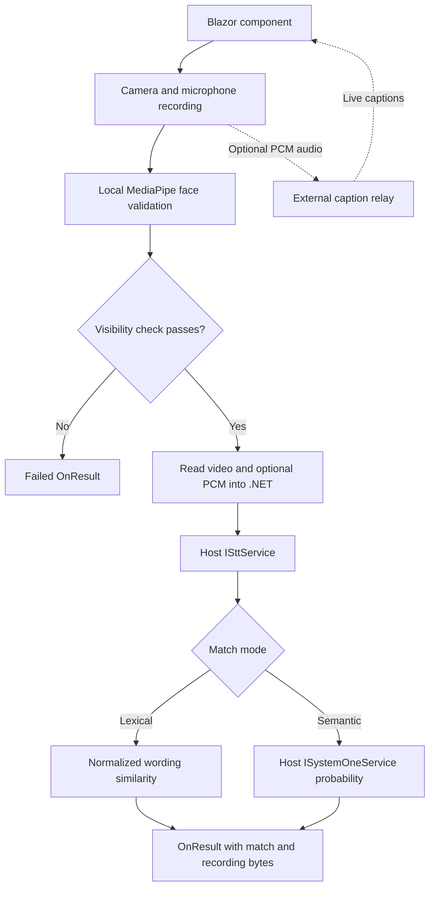

# Project index

Source analysis and implementation notes updated on 2026-10-14. This index covers maintained source, tests, and bundled assets; generated `bin/`, `obj/`, and local verification artifacts are excluded. See the [README](../README.md) for setup, usage, parameters, service contracts, and troubleshooting.

## Project structure

| Path | Role |
| --- | --- |
| [CameraSpeechMatch.slnx](../CameraSpeechMatch.slnx) | Solution containing the Razor library, sample host, and .NET tests. |
| [src/CameraSpeechMatch/CameraSpeechMatch.csproj](../src/CameraSpeechMatch/CameraSpeechMatch.csproj) | `net10.0` Razor class library; Components.Web 10.0.11, MudBlazor `8.*`, and `.task` static-asset content type. |
| [src/CameraSpeechMatch.Sample/CameraSpeechMatch.Sample.csproj](../src/CameraSpeechMatch.Sample/CameraSpeechMatch.Sample.csproj) | `net10.0` ASP.NET Core host with a project reference to the library and MudBlazor `8.*`. Its root namespace is `CameraSpeechMatchSample`. |
| [.gitignore](../.gitignore) | .NET/Visual Studio build outputs and local tooling exclusions. |
| [README.md](../README.md) | User and integrator documentation. |

```text
camera-speech-match/
├── CameraSpeechMatch.slnx
├── README.md
├── docs/AGENT.md
├── tests/                       .NET service/component tests
└── src/
    ├── CameraSpeechMatch/
    │   ├── CameraSpeechMatch.razor / .razor.cs / .razor.css
    │   ├── service interfaces, request types, result, mode, comparer
    │   └── wwwroot/
    │       ├── js/                   browser recording, face checks, captions
    │       ├── vendor/mediapipe/1.0.1/
    │       └── background.png
    └── CameraSpeechMatch.Sample/
        ├── Program.cs
        ├── Configuration/          STT and SystemOne settings
        ├── Services/               gateway adapters and protocol helpers
        ├── Components/             app shell, routing, layout, pages
        ├── Properties/launchSettings.json
        ├── appsettings*.json
        └── wwwroot/app.css
```

## Library source map

| File | Responsibility and useful entry points |
| --- | --- |
| [CameraSpeechMatch.razor](../src/CameraSpeechMatch/CameraSpeechMatch.razor) | MudBlazor UI: recording controls, prompt, camera preview, face guidance, timer, captions, and results. |
| [CameraSpeechMatch.razor.cs](../src/CameraSpeechMatch/CameraSpeechMatch.razor.cs) | Component parameters and state, JS import, auto-start, video/PCM reading, transcription, matching, retry, cancellation, and disposal. Both completion callbacks share `CompleteTranscriptionAsync`; `OnTranscriptionCompletedWithPcm` accepts the separate PCM stream. |
| [CameraSpeechMatch.razor.css](../src/CameraSpeechMatch/CameraSpeechMatch.razor.css) | Isolated responsive styling. The live preview uses centered `object-fit: cover` with horizontal mirroring; recorded playback removes mirroring. |
| [_Imports.razor](../src/CameraSpeechMatch/_Imports.razor) | Component Web and MudBlazor imports. |
| [CameraSpeechMatchMode.cs](../src/CameraSpeechMatch/CameraSpeechMatchMode.cs) | Public `Lexical` and `Semantic` match modes. |
| [CameraSpeechMatchResult.cs](../src/CameraSpeechMatch/CameraSpeechMatchResult.cs) | Processing status, `LexicalSimilarityPercent`, `MinimumLexicalSimilarityPercent`, `SemanticSimilarityPercent`, `MinimumSemanticSimilarityPercent`, text, media bytes/metadata, and errors. Only the selected mode's minimum is populated. Audio uses the video's base file name with `.pcm` and media type `application/octet-stream`. Successful results reuse the PCM bytes passed to STT. Match acceptance is private component state. |
| [ISttService.cs](../src/CameraSpeechMatch/ISttService.cs) | Host transcription boundary: `IsAvailable` and `TranscribeAsync`. |
| [SttTranscribeRequest.cs](../src/CameraSpeechMatch/SttTranscribeRequest.cs) | Normalized language and optional `PcmAudioContent`. PCM is fixed at mono 16 kHz signed 16-bit little-endian. Recorded video is supplied only on the result. |
| [ISystemOneService.cs](../src/CameraSpeechMatch/ISystemOneService.cs) | Host semantic boundary: `IsAvailable` and `NoulTypeAsync`. |
| [SystemOneMatchProbabilityRequest.cs](../src/CameraSpeechMatch/SystemOneMatchProbabilityRequest.cs) | Comparison texts and structured task/rules/acceptance criteria passed to the semantic provider. |
| [SpeechTranscriptComparer.cs](../src/CameraSpeechMatch/SpeechTranscriptComparer.cs) | Public `SpeechTranscriptComparer.Compare` and `SpeechTranscriptComparison` record. Normalizes wording, checks equality, and calculates Levenshtein similarity. |

## Browser modules

| File | Responsibility and useful entry points |
| --- | --- |
| [camera-speech-match.js](../src/CameraSpeechMatch/wwwroot/js/camera-speech-match.js) | Owns media tracks, recorder, optional PCM capture/caption sessions, timers, finalization, stream transfer, playback, and cleanup. Prepares PCM before recording and rechecks face evidence afterward. Playback does not depend on captions. |
| [pcm-recording.js](../src/CameraSpeechMatch/wwwroot/js/pcm-recording.js) | Opt-in audio graph and PCM collector. Reuses the worklet/resampler, limits audio to 10 MiB, flushes the partial final chunk, and releases its graph without stopping shared camera/microphone tracks. |
| [camera-speech-face.js](../src/CameraSpeechMatch/wwwroot/js/camera-speech-face.js) | Face bounds projection into the cropped/mirrored preview, positioning guidance, visibility validation, worker orchestration, and timestamp freshness. Exports `normalizeFaceOptions`, `projectFaceBounds`, `evaluateFacePosition`, `evaluateFaceVisibility`, `createFaceVisibilityValidation`, and `createFaceTracker`. |
| [camera-speech-face-worker.js](../src/CameraSpeechMatch/wwwroot/js/camera-speech-face-worker.js) | Classic Web Worker. Loads MediaPipe, creates a CPU Face Landmarker in VIDEO mode with `numFaces: 1`, and returns bounds from detected landmarks. Handles `initialize` and `frame`; emits `ready`, `result`, or `error`. |
| [speech-session.js](../src/CameraSpeechMatch/wwwroot/js/speech-session.js) | WebSocket protocol, AudioWorklet pipeline, PCM resampling, interim/final transcript accumulation, session outcomes, timeouts, and cleanup. Main calls are `createSpeechSession`, `startSpeechSession`, `stopSpeechSession`, and `disposeSpeechSession`. Also includes generic transcript insertion helpers. |
| [speech-input-worklet.js](../src/CameraSpeechMatch/wwwroot/js/speech-input-worklet.js) | Registers `stt-pcm-capture`; collects the first input channel into roughly 40 ms floating-point chunks. Controlled mode excludes pre/post recording audio and flushes on stop; legacy caption mode starts enabled. |

The component imports `./_content/CameraSpeechMatch/js/camera-speech-match.js` after its first interactive render. Browser modules import their dependencies relative to that location. The face worker resolves its vendor assets from `../vendor/mediapipe/1.0.1/` relative to the main face module.

## Sample source map

| File | Responsibility |
| --- | --- |
| [Program.cs](../src/CameraSpeechMatch.Sample/Program.cs) | Registers Interactive Server, MudBlazor, gateway settings, the singleton STT service, and the typed HTTP SystemOne service; maps the host endpoints/assets. |
| [Configuration/GatewaySettings.cs](../src/CameraSpeechMatch.Sample/Configuration/GatewaySettings.cs) | `SttGateway`, `SpeechInput`, and `SystemOne` configuration defaults adapted from Intra. |
| [Services/Stt/SttService.cs](../src/CameraSpeechMatch.Sample/Services/Stt/SttService.cs) | Implements `ISttService` directly with `ClientWebSocket`: fixed PCM configuration, readiness, audio delivery at recording rate, bounded fragmented events, final transcript accumulation, completion/deadlines, and socket cleanup. |
| [Services/SystemOne/SystemOneService.cs](../src/CameraSpeechMatch.Sample/Services/SystemOne/SystemOneService.cs) | Implements `ISystemOneService` through Intra's boolean endpoint. Maps instructions/criteria and validates probability, usage, HTTP status, strict JSON, and byte limits. |
| [Components/App.razor](../src/CameraSpeechMatch.Sample/Components/App.razor) | HTML shell, static stylesheet references, import map, interactive head/routes, MudBlazor script, and Blazor bootstrap. |
| [Components/Routes.razor](../src/CameraSpeechMatch.Sample/Components/Routes.razor) | Router, main layout, focus handling, and not-found page. |
| [Components/_Imports.razor](../src/CameraSpeechMatch.Sample/Components/_Imports.razor) | Host, library, render-mode, and MudBlazor imports. |
| [Components/Pages/Home.razor](../src/CameraSpeechMatch.Sample/Components/Pages/Home.razor) | `/` demo with PCM capture enabled and initial English language/prompt. Shows modes/results/playback and clears the latest result on reset. |
| [Components/Pages/Error.razor](../src/CameraSpeechMatch.Sample/Components/Pages/Error.razor) | `/Error` page with request identifier and development guidance. |
| [Components/Pages/NotFound.razor](../src/CameraSpeechMatch.Sample/Components/Pages/NotFound.razor) | `/not-found` page. |
| [Components/Layout/MainLayout.razor](../src/CameraSpeechMatch.Sample/Components/Layout/MainLayout.razor) | MudBlazor providers, page body, and Blazor error UI. |
| [Components/Layout/MainLayout.razor.css](../src/CameraSpeechMatch.Sample/Components/Layout/MainLayout.razor.css) | Error UI styling. |
| [Components/Layout/ReconnectModal.razor](../src/CameraSpeechMatch.Sample/Components/Layout/ReconnectModal.razor) | Circuit reconnection dialog and script reference. |
| [Components/Layout/ReconnectModal.razor.js](../src/CameraSpeechMatch.Sample/Components/Layout/ReconnectModal.razor.js) | Handles reconnection state, retry, and circuit resume. |
| [Components/Layout/ReconnectModal.razor.css](../src/CameraSpeechMatch.Sample/Components/Layout/ReconnectModal.razor.css) | Reconnection dialog styling and animation. |
| [wwwroot/app.css](../src/CameraSpeechMatch.Sample/wwwroot/app.css) | Host typography, body, and validation/error styling. |
| [Properties/launchSettings.json](../src/CameraSpeechMatch.Sample/Properties/launchSettings.json) | `http` launch profile, Development environment, and `http://localhost:5295`. |
| [appsettings.json](../src/CameraSpeechMatch.Sample/appsettings.json) | Logging, allowed hosts, gateway address, service enablement, and deadlines/limits. |
| [appsettings.Development.json](../src/CameraSpeechMatch.Sample/appsettings.Development.json) | Development logging defaults. |

## Execution and data flow



Provider and media-processing failures also lead to a failed `OnResult`. The diagram's successful result means processing completed; its match may still be rejected.

The component's private states are `NotStarted`, `Ready`, `Recording`, `Processing`, `Completed`, and `Error`. Retry returns to `NotStarted`. Recording can begin automatically only once per attempt, after current browser-local face evidence has been checked.

Both completion callbacks validate face status, prompt/mode settings, media type, and sizes before reading any bytes. Video is limited to 100 MiB; optional PCM to 10 MiB with complete 16-bit samples. `CapturePcmAudio` defaults to false and is captured per recording attempt. The shared completion logic calls STT, rejects empty text, calculates lexical similarity, and optionally calls SystemOne. Both scores and minimums use 0–100 percentages. Lexical mode uses `MinimumLexicalSimilarityPercent` (default 100); Semantic mode uses `MinimumSemanticSimilarityPercent` (default 80). The provider returns a 0–1 probability, validated before conversion to percent. Both minima are inclusive and validated for the selected mode. Successful results include the same `PcmAudioContent` sent to STT. `CompleteFailureAsync` clears both video and PCM content and publishes the error.

The sample follows Intra's PCM WebSocket gateway rather than a file-upload API. Audio is captured locally during recording, then delivered after recording at 32,000 bytes/second in roughly 40 ms chunks while responses are read concurrently. This pacing prevents buffered audio from overrunning the gateway's finalization window. Finalization begins after the last audio chunk; the overall transcription deadline includes connection, readiness, delivery, and completion.

The SystemOne adapter posts `state`, structured `instructions`, and true/false `criteria` to `api/system-one/v1/boolean`. It exposes only the probability needed by the library; choice/score operations and the Intra project itself are not dependencies.

Attempt version checks, completion guards, and cancellation tokens prevent stale work from publishing into a newer attempt. JavaScript separately tracks attempt IDs and releases camera tracks, workers, recording chunks, timers, sockets, and object URLs on reset/disposal. Page navigation has immediate browser-side cleanup.

## Integration boundaries

| Boundary | Supplied here | Host responsibility |
| --- | --- | --- |
| Transcription | Public interface/request, opt-in PCM capture, and sample gateway implementation | Configure a compatible gateway or supply another provider. Enable PCM capture to supply audio; the request contains only PCM and language. |
| Semantic comparison | Public interface/request, probability validation, and sample boolean adapter | Configure the gateway or supply another provider returning a finite probability in `[0, 1]`. |
| Live captions | Browser PCM capture and WebSocket client | Compatible external relay. No relay endpoint is mapped by the sample. |
| Media retention | Recording bytes and metadata in `OnResult` | Persistence, upload, and any host playback UI. |
| Rendering | Razor/MudBlazor component and static assets | Interactive rendering, service registration, MudBlazor assets/providers, and generated scoped CSS. |

## Bundled assets

| Asset | Purpose |
| --- | --- |
| [background.png](../src/CameraSpeechMatch/wwwroot/background.png) | Bundled image; no reference from maintained source was found during analysis. |
| [asset-manifest.json](../src/CameraSpeechMatch/wwwroot/vendor/mediapipe/1.0.1/asset-manifest.json) | MediaPipe package version 1.0.1, model identity, upstream source locations, expected sizes, and SHA-256 digests. |
| [vision_bundle.js](../src/CameraSpeechMatch/wwwroot/vendor/mediapipe/1.0.1/vision_bundle.js) | MediaPipe Tasks Vision runtime loaded by the worker. |
| [face_landmarker.task](../src/CameraSpeechMatch/wwwroot/vendor/mediapipe/1.0.1/face_landmarker.task) | Face Landmarker float16 model, version 1. |
| [wasm/](../src/CameraSpeechMatch/wwwroot/vendor/mediapipe/1.0.1/wasm/) | SIMD and non-SIMD JavaScript loaders and WASM binaries: `vision_wasm_internal.{js,wasm}` and `vision_wasm_nosimd_internal.{js,wasm}`. |
| [LICENSE](../src/CameraSpeechMatch/wwwroot/vendor/mediapipe/1.0.1/LICENSE) | Bundled Apache-2.0 license. |

The model and both WASM binaries match their manifest sizes and hashes. In the supplied workspace, the three vendor JavaScript files and `LICENSE` use CRLF line endings; their sizes and hashes match the manifest after CRLF-to-LF normalization. Preserve that distinction when checking upstream asset integrity.

## Analysis findings and current gaps

| Finding | Impact / next change location |
| --- | --- |
| Post-recording STT uses a real-time gateway | Processing takes approximately the recording duration plus finalization. The default overall deadline is 300 seconds; recordings near that duration can exhaust the budget. |
| PCM capture is opt-in | The sample enables it. Other hosts must enable `CapturePcmAudio` to supply audio in the STT request; the sample STT adapter rejects missing PCM. |
| Face-position settings are advisory | Acceptance checks full detected-face visibility and timestamp freshness, independently of center/size guidance. Change `evaluateFaceVisibility` and recording validation if acceptance requirements change. |
| Worker requests one detected face | There is no explicit multiple-face rejection, identity comparison, or liveness check. Face checks should be understood within this scope. |
| Recording is buffered in the browser and .NET | Duration is limited to 300 seconds and .NET transfer to 100 MiB, but the implementation is not a streaming media-storage pipeline. |
| Prompt and match settings are read at finalization | They are not frozen when recording begins. Hosts should avoid changing the prompt/mode/cutoff during an active attempt if those values must remain fixed. |
| MudBlazor uses `8.*`; no `global.json` or package lock file is supplied | SDK and dependency resolution are not fully pinned. Review the project files when reproducible builds are required. |
| No CI configuration is supplied | Automated .NET tests are available; a CI pipeline still needs to run them. |

## Where to make changes

| Change | Start here |
| --- | --- |
| Layout, text, result display, or responsive styling | `CameraSpeechMatch.razor` and `CameraSpeechMatch.razor.css`. |
| Component parameters, result fields, size limit, or error mapping | `CameraSpeechMatch.razor.cs` and `CameraSpeechMatchResult.cs`. |
| Lexical normalization or similarity calculation | `SpeechTranscriptComparer.cs`. |
| Match minima, validation, or semantic criteria | `CompleteTranscriptionAsync`, `GetMatchConfigurationError`, and `CreateSemanticMatchRequest` in `CameraSpeechMatch.razor.cs`. |
| Provider integration | Sample gateway adapters and `Program.cs`; custom hosts can implement the same public interfaces. |
| PCM recording format/lifecycle | `pcm-recording.js`, controlled worklet mode, and shared component completion logic. |
| Recording codecs, timers, playback, or browser cleanup | `camera-speech-match.js`. |
| Face cropping, guidance, freshness, or end-of-recording checks | `camera-speech-face.js`; worker inference settings are in `camera-speech-face-worker.js`. |
| Caption protocol, PCM format, or timeouts | `speech-session.js` and `speech-input-worklet.js`. |
| MediaPipe update | Versioned vendor directory, asset manifest, worker loader, and asset root in `camera-speech-face.js`. |

## Verification performed

- Release build passed with .NET SDK 10.0.400, zero warnings, and zero errors.
- 86 xUnit/bUnit tests passed, covering STT sequencing/pacing/deadlines/errors against a loopback WebSocket server, fragmented frames, SystemOne strict HTTP/JSON contracts, and component matching/minimum validation, semantic percentage conversion/display, stream validation, PCM result retention, cancellation, and compatibility.
- Earlier verification passed 11 Node.js browser-module tests with Node 24.21.0, covering conversion, capture boundaries/tail flushing, limits, retry, freshness rechecks, face rejection, caption-independent playback, and navigation cleanup. That test file is absent from the current checkout.
- The configured gateway recognized synthetic English PCM as “This is a sample text for testing.” Lexical matching returned 100% similarity. SystemOne returned 0.96 for that match and 0.01 for a mismatching statement.
- The sample returned HTTP 200 and rendered interactively in Chromium. Its gateway services resolve without provider calls during page rendering.
- Chromium integration with synthetic camera/audio and deterministic face bounds exercised the real AudioWorklet, MediaRecorder, Blazor byte transfer, and configured gateways. Lexical and Semantic matches succeeded; the semantic match returned 0.96 and a mismatch returned 0.01 with `Succeeded == true`. Caption-independent recorded playback advanced successfully, and retry cleared the old result.
- The earlier bundled-asset hash check remains applicable: model/WASM bytes match directly; vendor text matches after LF normalization.
- Local documentation links/heading anchors resolve, and all 16 component parameters have README table entries.

## Tests and commands

| Path | Coverage |
| --- | --- |
| [tests/CameraSpeechMatch.Tests](../tests/CameraSpeechMatch.Tests/) | xUnit/bUnit service, WebSocket transport, and component tests. |

```bash
dotnet build CameraSpeechMatch.slnx --configuration Release
dotnet test CameraSpeechMatch.slnx --configuration Release
```

Real webcam face detection and external live captions require separate device/relay validation. Synthetic media and deterministic face bounds are used for browser integration checks; production MediaPipe detection is covered separately by its runtime assets and visibility logic.

Keep this index aligned with source changes. Document public behavior in the README and module ownership/analysis findings here.
